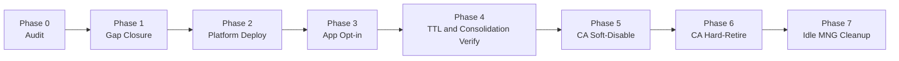
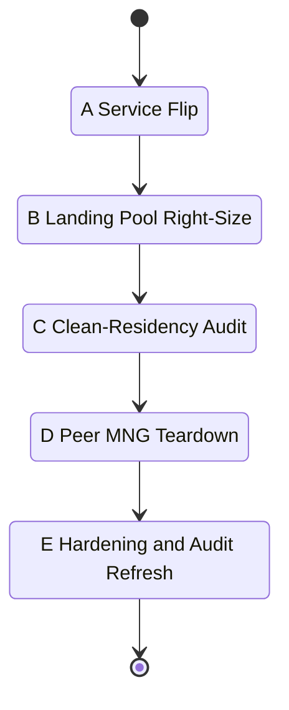
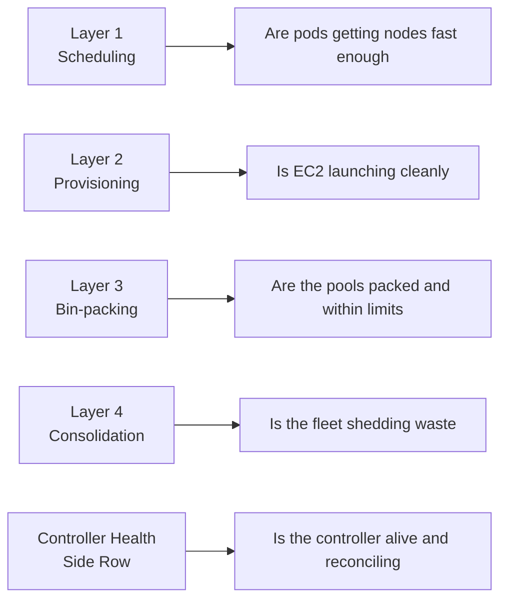
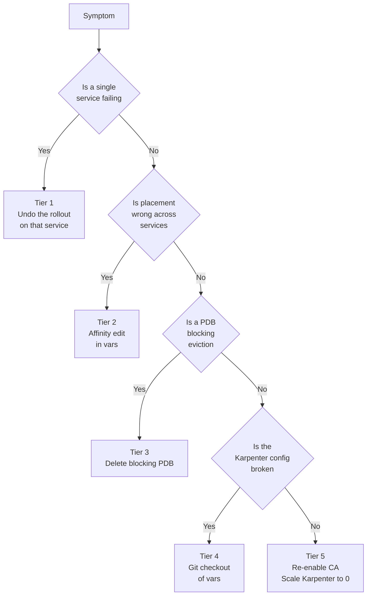
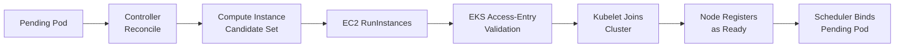

# Migrating EKS from Cluster Autoscaler to Karpenter

A field report from the platform team, covering design, phased deployment across five environments, retirement of the incumbent autoscaler, observability, and the failure modes that shaped the runbook.

## 1. Executive summary

The platform team ran a Karpenter migration across development, staging, production, an isolated partition cluster, and a customer-edge cluster. The design keeps two Kubernetes IAM identities: an IRSA-bound controller role and a node instance profile registered as an EKS access entry of type `EC2_LINUX`. Three NodePools cover the workload matrix: an arm64 `default`, an amd64 `x86`, and an amd64 `sandboxed-runtime` pool (SRT below) for gVisor-style isolated code execution. Rollout is a seven-phase sequence: audit, gap closure, platform deploy, per-service opt-in, TTL and consolidation verification, CA soft-disable, CA hard-retire, plus an idle managed node group cleanup. Retirement itself is a five-state A-to-E machine, tracked separately from the deploy sequence. The migration surfaced four categories of blocking issues before Karpenter was safe to enable: hard-pinned node group affinities, stale vendor labels, missing memory-optimized instance families, and an AL2023 x86 cloud-init race. Development retains CA as a dual-track fallback. Every other cluster fully retired CA. Observability sits on four Prometheus metric layers plus a controller-health side row.

## 2. Why migrate: CA vs Karpenter

CA scales pre-defined Auto Scaling Groups. Instance shapes are fixed per group. Latency for a scale-out reflects an ASG launch cycle, roughly 90 seconds end to end, and CA's decision loop can only choose an ASG, not a shape. Karpenter dispatches `ec2:RunInstances` directly, picking an instance type per pending pod batch out of a declared candidate list, and typically completes provisioning in about 30 seconds.

| Dimension | Cluster Autoscaler | Karpenter |
|---|---|---|
| Provisioning path | ASG desired-capacity update | Direct `ec2:RunInstances` |
| Instance choice | Fixed per node group | Per-pod, from a candidate list |
| Scale-out latency | ~90 s | ~30 s |
| Consolidation | External (needs bin-packing tools) | Native `WhenEmptyOrUnderutilized` |
| Configuration surface | ASG + launch templates + tags | `NodePool` + `EC2NodeClass` CRDs |
| Discovery | ASG tags | Subnet and security-group tag selectors |
| Interruption handling | External | SQS queue + EventBridge rules |
| Node lifecycle | ASG-owned | `NodeClaim` CRD, owned by controller |
| Multi-arch in one pool | Requires multiple ASGs | One NodePool with `In [arm64, amd64]` |

The operational win is not raw speed. It is that a pod's placement constraints select the instance, so adding a memory-hungry workload no longer requires a new ASG plus a Terraform round-trip. The trade-off is that pod-level affinity discipline becomes load-bearing: an accidentally over-broad affinity spills onto the wrong shape, and the platform team owns the discovery-tag scheme end to end.

## 3. IAM and identity design

The design uses two roles. The controller role, `karpenter-controller`, is IRSA-bound. Its trust policy targets the cluster OIDC provider and the controller service account. The node role, `karpenter-node`, is an EC2 instance profile attached to launched instances and is also registered as an EKS access entry of type `EC2_LINUX` so provisioned nodes can join.

The controller policy grants:

- EC2 write: `RunInstances`, `CreateFleet`, `TerminateInstances`, `CreateLaunchTemplate`, `CreateTags`
- EC2 read: `Describe*`
- IAM: `PassRole` scoped to the node role ARN; `GetInstanceProfile`, `TagInstanceProfile`, `CreateInstanceProfile`, `DeleteInstanceProfile`, `AddRoleToInstanceProfile`, `RemoveRoleFromInstanceProfile`
- SQS: `ReceiveMessage`, `DeleteMessage`, `GetQueueAttributes` for the interruption queue
- SSM: `GetParameter` for AMI alias lookup
- EKS: `DescribeCluster`
- Pricing: `GetProducts`

The node role attaches the standard four AWS-managed policies: `AmazonEKSWorkerNodePolicy`, `AmazonEKS_CNI_Policy`, `AmazonEC2ContainerRegistryReadOnly`, `AmazonSSMManagedInstanceCore`.

Instance-profile ownership deserves a note. Terraform owns the node role. Karpenter creates and destroys the instance profile at runtime, one per `EC2NodeClass`. That is why the controller policy includes `CreateInstanceProfile` and `RemoveRoleFromInstanceProfile`. Do not attempt to pre-create the instance profile in Terraform; the controller will fail to reconcile.

IRSA was chosen over EKS Pod Identity because every cluster already has an OIDC provider and the surrounding tooling (audit scripts, drift checks) already targets IRSA trust policies. Pod Identity is deferred to a later cleanup pass.

Partition-specific handling matters on the isolated partition. Every ARN uses the `aws-us-gov` partition prefix. The `pricing:GetProducts` permission is omitted from the controller policy on the isolated partition because the Pricing API is not available there. Karpenter tolerates the missing pricing data and falls back to an on-cluster instance-type catalog.

## 4. NodePool and EC2NodeClass design

Three NodePools sit on top of two `EC2NodeClass` objects. During the AL2023 cloud-init workaround period (see section 8), staging temporarily carried three `EC2NodeClass` objects: the two long-lived classes plus a dedicated x86 class introduced to fix the userData race. Once the workaround stabilized, that third class was retained as the canonical x86 class.

- `default`: arm64, on-demand, m7g and m6g families for general workloads plus r7g.{2,4,8}xlarge for memory-heavy pods. All AZs.
- `x86`: amd64, on-demand, m7i, m6i, t3, c6i. Smaller limits than the arm64 pool because most workloads are already arm64.
- `sandboxed-runtime` (SRT): amd64, on-demand, c6i and m7a families. Carries the sandboxed-runtime taint (`runsc=true:NoSchedule`) and the matching label (`runsc: "true"`). Uses a custom AMI required by the sandboxed runtime.

On-demand only. Spot was removed from the v1 design for three reasons: consolidation semantics are easier to reason about when only the controller and expiry can disrupt a node; debugging cascading pending pods is simpler; the win from spot is a cost optimization that belongs after CA is retired, not during the migration.

Disruption settings are uniform across pools:

```yaml
disruption:
  consolidationPolicy: WhenEmptyOrUnderutilized
  consolidateAfter: 30s
  expireAfter: 168h
```

`WhenEmptyOrUnderutilized` catches both drained nodes and packing improvements. The 30-second consolidation delay prevents thrash on transient pod churn. The 168-hour (7-day) `expireAfter` guarantees a full node roll every week, which stops long-tail AMI drift and keeps the fleet uniform. On clusters that undergo Kubernetes minor upgrades, expect a churn spike synchronized with the upgrade; that is expected and desired.

## 5. Subnet and security group discovery

Karpenter selects subnets and security groups by tag. The default `EC2NodeClass` uses:

```yaml
subnetSelectorTerms:
  - tags:
      karpenter.sh/discovery: <cluster-name>
securityGroupSelectorTerms:
  - tags:
      karpenter.sh/discovery: <cluster-name>
```

Tagging is a Terraform-side responsibility. The migration includes a one-shot script that adds `karpenter.sh/discovery=<cluster-name>` to every private subnet that is not part of the SRT pool.

The SRT `EC2NodeClass` uses a different selector: `node-group=sandboxed-runtime`. The reason is defensive. Sandboxed subnets are physically isolated from the general-purpose subnets, and if they carried the same `karpenter.sh/discovery` tag, the default class could accidentally pick them and land a general workload on a sandboxed-only subnet. Two disjoint tag namespaces make the intent structural: the default class cannot see the sandboxed subnets even if a future engineer forgets the distinction. On the isolated partition, the platform team explicitly de-tagged SRT subnets to enforce this.

## 6. Chicken-and-egg controller placement

Karpenter provisions nodes for pending pods, but the Karpenter controller pod itself needs a node. If it lands on a Karpenter-provisioned node and that node consolidates or expires, the controller can flap. Worse, during CA retirement, an unavailable controller cannot provision replacement nodes for itself.

The fix is a node affinity on the controller Deployment:

```yaml
affinity:
  nodeAffinity:
    requiredDuringSchedulingIgnoredDuringExecution:
      nodeSelectorTerms:
        - matchExpressions:
            - key: karpenter.sh/nodepool
              operator: DoesNotExist
```

The label `karpenter.sh/nodepool` is only present on nodes provisioned by Karpenter. `DoesNotExist` pins the controller to the pre-existing managed node group. During CA and Karpenter coexistence, that lands the controller on the CA-managed pool. After CA retirement, that lands it on the surviving system managed node group (the "landing pool"; see section 12).

## 7. Interruption handling

Karpenter subscribes to an SQS queue populated by EventBridge rules covering four event categories: spot interruption warnings, rebalance recommendations, instance state changes, and scheduled maintenance events. The controller polls the queue every 10 seconds. When it observes a two-minute interruption warning, it cordons and drains the node so Kubernetes moves pods out before AWS reclaims the instance.

The interruption queue is required even for on-demand-only fleets. Scheduled maintenance events and instance state-change notifications flow through the same pathway and produce graceful drains for AWS-initiated retirements. On production, the API endpoint is private, so the interruption path is the only reliable signal for out-of-band events.

## 8. Breaking changes fixed before enablement

Four blocking issues showed up in the audit. Each had to be closed before Karpenter could take any load.

**Hard-pinned node group affinities.** Three workloads pinned themselves to a specific CA-managed node group name via `eks.amazonaws.com/nodegroup`. These are the memory-heavy batcher, the cold-tier reader, and every storage-compactor job. The label is CA-node-only; Karpenter nodes never carry it, so pending pods would sit forever. The fix removes the pin and keeps the architecture affinity `kubernetes.io/arch: arm64`. There is a subtle trap: clearing the affinity without a replacement `group: default` re-pin can spill a cheap workload onto an expensive memory-optimized node, because Karpenter will pick whatever instance is cheapest per pod but honors every existing tolerance. Pair the clear with an explicit group re-pin.

**Stale internal `<vendor>/nodegroup` labels.** An internal label appears in many `nodeAffinity` expressions across app manifests. It only exists on CA nodes. Karpenter does not replicate it. The fix guards the affinity off (either delete it, or gate it with a per-target var that is false on Karpenter clusters).

**Missing memory-optimized instances in the default pool.** The initial `default` NodePool listed only m7g and m6g. Workloads that previously lived on r7g.8xlarge went pending because the pool had no instance offering ≥ 128 GB. Adding r7g.{2,4,8}xlarge to the candidate list resolved it.

**AL2023 x86 cloud-init race.** On AL2023 x86 AMIs, the `nodeadm-config.service` unit races with cloud-init stage 2. Stage 2 is what delivers the `NodeConfig` document. If nodeadm-config starts first, the node fails to join. The fix is a dedicated x86 `EC2NodeClass` with explicit MIME multipart userData that orders the two units correctly. This is why staging temporarily carried three `EC2NodeClass` objects during the workaround period.

A separate but related issue: HPA targeting a StatefulSet is banned by internal policy after an incident on 2026-07-16. The time-series write-path service HPA had min=max=3 (functionally neutered) but still needed deletion before Karpenter enablement, because the HPA object itself would prevent the StatefulSet from consolidating cleanly.

## 9. Seven-phase deployment sequence



**Phase 0, readiness audit.** The `audit.sh <env>` script runs nine per-check scripts in about 60 seconds and reports blocking affinities, PDB coverage, discovery tags, security-group tags, IAM shape, ECR mirror status, and metrics-server presence.

**Phase 1, gap closure.** Remove blocking affinities, tag private subnets, wire the `karpenter_enabled` boolean through Terragrunt, mirror the controller image and Helm chart to the per-environment ECR, and add the Karpenter variable block to the platform vars file.

**Phase 2, platform deploy.** Kluctl applies the Karpenter Deployment, both `EC2NodeClass` objects, and all three `NodePool` objects. Acceptance: controller at 2/2 within 2 minutes, all NodePools `Ready`.

**Phase 3, app-layer opt-in.** Per-service `karpenter_only: true` var flips the app's affinity from the CA node group to the new Karpenter pool. Deployments roll first; StatefulSets follow. `RollingUpdate` with `maxUnavailable=1` PDB on every workload.

**Phase 4, TTL and consolidation verification.** Ship a synthetic test pod; verify it provisions in under 60 seconds and that the node drains within 30 seconds of the consolidation cycle after the pod is deleted.

**Phase 5, CA soft-disable.** Scale CA to zero replicas. Do not remove the Deployment. This preserves a fast rollback.

**Phase 6, CA hard-retire.** Kluctl deletes the CA Deployment. If CA was installed via an EKS Blueprints Helm release, `helm uninstall` it explicitly.

**Phase 7, idle MNG cleanup.** Delete every managed node group that has zero live instances from Terraform.

## 10. Environment-specific differences

Five environments were migrated. Each behaves differently.

**Development.** Dual-track steady state. CA keeps cluster-critical DaemonSets and system pods on managed node groups; Karpenter takes the memory-heavy, SRT, and x86 workloads. Development retains CA indefinitely as a fallback. Phase 6 does not run here. This is the most permissive environment and where affinity-flip regressions surface first.

**Staging.** Full retirement. All workloads move to Karpenter. Staging is where the HPA-on-StatefulSet policy violations were surfaced and cleared, and where the AL2023 x86 cloud-init workaround was first validated. Combined HPA plus Karpenter load tests run here.

**Production.** Private endpoint cluster. A VPN-style mesh is required to reach the API. By the time Karpenter was staged for production, the CA Deployment had already been removed by an earlier ticket; only a lingering EKS Blueprints Helm release remained, which was uninstalled during phase 6. The SRT NodePool CPU limit had to be widened from 50 to 200 CPU because production runs the largest fleet of gVisor-style sandboxed pods.

**Isolated partition.** The `aws-us-gov` partition. IAM ARNs, ECR endpoints, and SSM parameter paths all use the partition prefix. `pricing:GetProducts` is omitted from the controller policy. The ECR mirror is in-partition (mirrored from a separate account). SRT subnets are explicitly de-tagged so the default class cannot select them. The rollout here used a five-stage bake pattern (section 11).

**Customer-edge.** Customer-managed IAM keys, single-AZ, no SRT tier. Several services that appear in other environments are deferred; the audit runs a smaller allowlist here. The customer-edge cluster demonstrates that the design collapses cleanly when the SRT tier is not needed: the SRT `EC2NodeClass` and `NodePool` are simply omitted.

ECR mirroring complexity grows with partition count. Every environment has its own ECR registry; every registry needs the controller image and the Helm chart mirrored. Cross-account and cross-partition mirroring requires per-target `syncimages` invocations. This is one of the most under-estimated costs in the migration.

## 11. Staged deploy pattern on the isolated partition

The isolated partition rollout used a five-stage bake pattern with ≥ 30-minute observation windows between stages. Order and reasoning:

1. Low-risk stateless services. Web-facing HTTP tiers with clean PDB coverage and no local state. Failure here reverts trivially.
2. The intake tier. High traffic, stateless. Move it before the batch-writing sibling because the sibling is what actually holds state; migrating the intake tier first lets the sibling continue to write on CA nodes while the intake tier proves the Karpenter path.
3. The wide-column DB. StatefulSet with PVCs. Requires `karpenter.sh/do-not-disrupt: "true"` (see section 14). Move only after stages 1 and 2 are quiet.
4. The sharded read tier. Has app-layer primary+secondary replication (`CHANNEL_NODE_ASSIGNMENT=v2+secondary`). Losing a single pod falls back to the secondary at higher latency; no data loss.
5. The batch-writing sibling. Kafka consumer group with per-pod RWO-EBS-backed batches. This is the highest-risk stage because Kafka rebalances partitions across siblings on eviction, but per-pod batches cannot be inherited: a stranded batch stays stranded until the original pod re-schedules on a node that can attach the same PVC.

A special step, sometimes called stage 1.5, applies immediately before stage 2. Ephemerally annotate every batch-writing sibling pod with `cluster-autoscaler.kubernetes.io/safe-to-evict=false`. As the intake tier vacates CA nodes in stage 2, CA would otherwise consolidate nodes and drain the sibling; the annotation blocks that drain. Remove the annotation once stage 5 begins.

## 12. CA retirement five-phase state machine

Retirement is orthogonal to the seven-phase deploy sequence. Phases A through E can span multiple deploy-sequence phases.



**Phase A, service flip.** For every service still landing on a CA node group, flip `karpenter_only: true`. Continue until no service is a "leaker" onto CA-managed nodes.

**Phase B, right-size the landing pool.** The system managed node group is the landing pool for pods that must not run on Karpenter nodes: the Karpenter controller itself, CoreDNS, the EBS CSI controller, CA itself (until phase D), and DaemonSets. Right-size this MNG via a rolling replace that respects `maxUnavailable=1`.

**Phase C, clean-residency audit.** Every pod on the landing pool must be on an allowlist. If a pod that is not on the list is running there, it is a leaker and phase A repeats for that service.

**Phase D, peer MNG teardown and CA controller removal.** Delete every peer managed node group from Terraform. Flip `cluster_autoscaler.enabled: false`. Helm uninstall the EKS Blueprints CA release if present.

**Phase E, post-migration hardening.** Update audit scripts to no longer check for CA. Re-run the end-to-end audit and require it green. Add supersession banners to old runbooks.

Development is the exception. Only phases A (for the services actually moved) and C (the residency audit) apply. Phases B, D, and E do not, because CA remains as a permanent fallback.

## 13. Observability plan

Four Prometheus layers plus a controller-health side row.



**Layer 1, scheduling health.** Key metrics: `karpenter_pods_unbound_time_seconds`, `karpenter_scheduler_unschedulable_pods_count`, `karpenter_scheduler_queue_depth`. Primary alerts: unschedulable pods > 5 for ≥ 10 min; bind-latency p95 > 300 s for ≥ 10 min.

**Layer 2, provisioning.** Key metrics: `karpenter_nodeclaims_created_total`, `karpenter_nodes_created_total`, `karpenter_cloudprovider_errors_total`, `karpenter_nodeclaims_terminated_total`, `karpenter_cloudprovider_instance_launch_duration_seconds_bucket`. Failure modes are triaged into three buckets: launch failures (EC2 API), registration failures (node registers with kube API), initialization failures (node is registered but not `Ready`). Primary alert: cloud-provider errors > 0.1 per 5 min for ≥ 10 min, paging.

**Layer 3, bin-packing.** Key metrics: `karpenter_nodepools_usage`, `karpenter_nodepools_limit`, per-node CPU and memory request ratios. Primary alert: usage-to-limit > 0.85 for ≥ 30 min per pool. This is the early warning for a pool that is about to reject new pods.

**Layer 4, consolidation.** Key metrics: `karpenter_voluntary_disruption_decisions_total{reason}`, `karpenter_nodes_disrupted_total{reason}`, `karpenter_disruption_replacement_nodeclaim_failures_total`, `karpenter_voluntary_disruption_consolidation_timeouts_total`. Primary alerts: no eligible-node decrease over 6 h while count remains > 0 (stuck consolidation); replacement failures sustained > 0 for ≥ 1 h.

**Controller-health side row.** `up{job="karpenter"}`, `controller_runtime_reconcile_errors_total`, `workqueue_depth{name=~"karpenter.*"}`. Primary alert: controller pod unavailable ≥ 5 min, paging.

## 14. High-availability considerations

PDB coverage is non-negotiable. Every workload that participates in Karpenter consolidation needs a `PodDisruptionBudget` with `maxUnavailable=1` at minimum. Without a PDB, consolidation will happily evict a sole replica.

Topology spread constraints matter as much as PDBs. Workloads that require multi-AZ spread carry `maxSkew: 1, whenUnsatisfiable: ScheduleAnyway`, which allows Karpenter to satisfy the constraint on scale-out without deadlocking scheduling if an AZ is briefly unavailable.

Two failure patterns emerged in HA analysis:

**Primary/secondary read-path fallback saved the migration.** The sharded read tier has app-layer replication with a secondary. When a single pod was consolidated during stage 4 of the isolated-partition rollout, the read path fell back to the secondary at higher latency without data loss. This behavior is what made stage 4 safe to run in the first place; a non-replicated read path would have required a different sequencing.

**A stateful sibling with PVC-bound per-pod state cannot inherit peers' work.** The batch-writing sibling has a dynamic Kafka consumer group. Kafka rebalances partitions to healthy siblings when a pod is evicted. Under normal circumstances that is fine, but the sibling holds an RWO EBS PVC per pod, and each pod batches writes for its own partitions. Siblings cannot attach a peer's RWO volume, so batches are stranded until the original pod re-schedules onto a node that can attach the same PVC. If the pod stays `Pending` for 15+ minutes, the batches are effectively lost until manual intervention.

Both patterns argue for `karpenter.sh/do-not-disrupt: "true"` on any workload where eviction cost is non-trivial. The wide-column DB carries it permanently. The batch-writing sibling carries it during high-load periods and always during CA-to-Karpenter transitions.

## 15. Audit script framework

The audit is a shell framework. It is read-only by design. Only `--fix-context` mutates local state (specifically, the kubeconfig context).

**`lib.sh`.** Provides `resolve_env()` which maps an environment name to a struct of `{profile, cluster, region, account, ns, discovery_tag}`. Provides color helpers. Provides a permissive `run()` wrapper that never causes the script to exit on a non-zero return. Provides `check_prereqs()` and a `check_context()` guard that refuses to run against the wrong cluster.

**Nine per-check scripts.** control-plane, cluster-autoscaler, topology, system-mng, placement, affinities, health, iam-infra, env-specific. Each script encodes per-environment constants at the top (expected node group names, expected label values, allowlisted namespaces). The env-specific script is where per-cluster oddities live.

**Orchestrator `audit.sh <env>`.** Supports `--only <check>` to run one check, `--skip <check>` to omit one, and `--fix-context` to switch kubeconfig context before running.

**Permissive-then-aggregate philosophy.** Each check runs to completion even if earlier calls fail. Missing resources produce warnings, not fatal exits. The orchestrator aggregates at the end and reports a per-check pass/warn/fail matrix. This matters because Karpenter migrations frequently involve half-configured clusters, and the audit needs to describe reality without aborting on the first inconsistency.

## 16. Preflight and post-verify pattern

Preflight and post-verify are separate scripts. Both use port-forwarding for smoke checks so they work against private-endpoint clusters over a VPN mesh.

**`karpenter_preflight_checks.sh`.** Verifies CLI prerequisites (`aws`, `kubectl`, `helm`, `kluctl`, `terragrunt`), validates the AWS profile against the expected account, checks the git worktree is clean, confirms EKS reachability, and reports an informational diff between the current ConfigMap state and the intended state. Nothing here mutates.

**`post_verify.sh`.** Runs after the deploy. Verifies the build version matches the chart, compares the target count against a baseline captured earlier, confirms Karpenter is being scraped by Prometheus (`up{job="karpenter"}` healthy, `karpenter_build_info` queryable), checks the rule-group count matches expectations, verifies the retention argument on the metrics StatefulSet, and confirms the config-reload endpoint returns HTTP 200. Uses port-forward with a 30-second readiness wait.

The baseline is captured once, before the migration begins, by curl-ing `/api/v1/targets` and `/api/v1/rules` against the pre-migration Prometheus. Diffs against this baseline are how the platform team catches silently dropped scrape targets during phase 6.

## 17. Rollback tiers

Rollback is tiered by cost. The lowest-cost tier is always tried first.



Tier 5 is why phase 5 (CA soft-disable) does not remove the CA Deployment. Scaling CA back up and scaling Karpenter to zero is a five-minute recovery from a state where Karpenter is provisioning wrongly-shaped nodes at scale.

## 18. Karpenter provisioning control flow



Each hop has an alertable metric in section 13. Pending-pod-to-controller-reconcile latency lives in Layer 1. RunInstances errors live in Layer 2 under `karpenter_cloudprovider_errors_total`. Access-entry validation failures show up as launch success but registration failure. Kubelet join failures show up as registered-but-not-Ready. Scheduler bind time is the pod-unbound-time metric closing.

## 19. Lessons learned

**Audit before touching anything.** The `audit.sh <env>` script found every blocking issue in section 8 before the platform team wrote a single line of Terraform. The four categories of breaking changes were all detected by the audit; none surfaced only in production. Any team attempting this migration should build the audit first and use its output as the phase 0 gate.

**IaC before Kubernetes.** Terraform IAM, subnet tags, security-group tags, and the ECR mirror all land before the first `kluctl deploy`. Landing them out of order produces silent failures that look like Karpenter bugs (nodes launch but fail to register, subnets are selected but pods stay pending) and burn hours of debugging.

**Stateless before stateful.** In the staged rollout, every stateless workload moves before any stateful workload. The rationale is empirical: stateless failures are recoverable by pod restart; stateful failures involve stranded EBS volumes and manual intervention.

**PDB is non-negotiable.** Consolidation without a PDB is a self-inflicted outage. The audit script explicitly checks PDB coverage on every workload.

**`karpenter.sh/do-not-disrupt` for state.** For workloads where eviction cost exceeds cluster-cost savings, the annotation is the correct answer. Do not try to work around it with topology spread or PDBs alone.

**Stage large rollouts.** The five-stage isolated-partition pattern with ≥ 30-minute bakes surfaced issues that a single-shot rollout would have compounded. The bake is not overhead; it is the observation window.

**Monitor TTL churn.** `expireAfter: 168h` produces a synchronized weekly churn spike. On upgrade weeks, that spike overlaps the upgrade churn. Plan capacity headroom accordingly and consider staggering `expireAfter` across pools if the spike is disruptive.

**ECR mirroring complexity grows with partition count.** Every partition needs its own registry, its own mirror pipeline, and its own credential path. Budget this as a first-class workstream, not a side task.

**Anonymized affinity flip is safer than taints.** During coexistence, changing an affinity is a Deployment-level operation with a clean rollback. Adding a taint is a node-level operation that requires draining. Prefer the affinity flip for every migration step; reserve taints for structural isolation like the sandboxed runtime.
